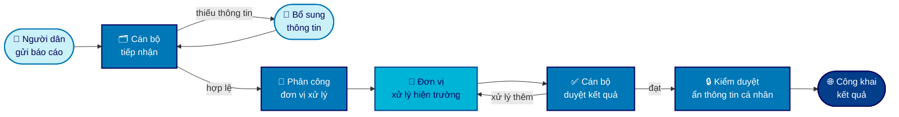
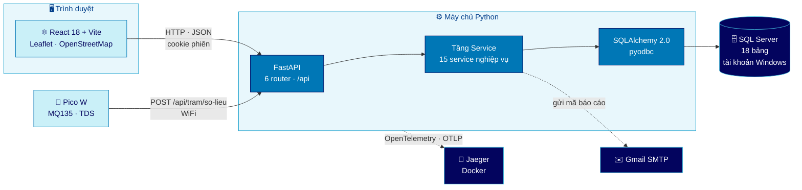

<div align="center">


<br/>


<br/>


<br/><br/>

**Một nơi để người dân báo sự cố môi trường, để phường điều phối xử lý, và để kết quả được công khai minh bạch.**

[Giới thiệu](#-giới-thiệu) ·
[Tính năng](#-tính-năng-theo-vai-trò) ·
[Quy trình](#-quy-trình-một-báo-cáo) ·
[Kiến trúc](#-kiến-trúc) ·
[Giao diện](#-giao-diện) ·
[IoT](#-thiết-bị-đo-iot) ·
[Tài liệu](#-tài-liệu)

</div>

<br/>

<table align="center">
  <tr>
    <td align="center" width="16%"><h2>14</h2><sub>USE CASE</sub></td>
    <td align="center" width="16%"><h2>16</h2><sub>MÀN HÌNH REACT</sub></td>
    <td align="center" width="16%"><h2>18</h2><sub>BẢNG SQL SERVER</sub></td>
    <td align="center" width="16%"><h2>15</h2><sub>SERVICE NGHIỆP VỤ</sub></td>
    <td align="center" width="16%"><h2>40</h2><sub>TEST CASE TỰ ĐỘNG</sub></td>
    <td align="center" width="16%"><h2>10 s</h2><sub>CHU KỲ ĐO IoT</sub></td>
  </tr>
</table>

---

## 🌊 Giới thiệu

Rác ùn ứ, khói đen, nước thải đổ ra kênh… thường được phát hiện bởi chính người dân, nhưng phản ánh dễ bị thất lạc
giữa điện thoại, tin nhắn và giấy tờ. **Cổng báo cáo sự cố môi trường và xử lý hiện trường** gom toàn bộ vòng đời
của một sự cố vào một hệ thống:

- 📍 **Người dân** chụp ảnh, ghim vị trí trên bản đồ và gửi phản ánh — **không cần tài khoản**, chỉ cần giữ *mã báo cáo*.
- 🗂️ **Cán bộ phường** tiếp nhận, phân công đơn vị, duyệt kết quả và công khai sau khi đã ẩn thông tin cá nhân.
- 🚛 **Đơn vị xử lý** nhận nhiệm vụ, ghi nhận hiện trường bằng vị trí thực tế, cập nhật tiến độ kèm ảnh.
- 📡 **Thiết bị đo IoT** (Raspberry Pi Pico W) tự gửi chỉ số **không khí** và **nước** về hệ thống, cảnh báo khi vượt ngưỡng.

> Đồ án môn **Phân tích và thiết kế hướng đối tượng** — phân tích, thiết kế bằng UML theo mô hình MVC,
> cài đặt thành ứng dụng web hoàn chỉnh có kết nối thiết bị đo thật.

---

## ✨ Tính năng theo vai trò

<table>
<tr>
<td width="50%" valign="top">

### 👤 Người dân
- Gửi báo cáo: loại sự cố, mô tả, **vị trí trên bản đồ**, tối đa 5 ảnh/video
- Nhận **mã báo cáo**, có thể gửi kèm vào email
- Tra cứu tiến độ, xem kết quả xử lý đã công khai
- Bổ sung thông tin khi cán bộ yêu cầu
- Lấy lại mã báo cáo qua email

</td>
<td width="50%" valign="top">

### 🧑‍💼 Cán bộ phường
- Bảng **tổng quan công việc** theo từng bước
- Tiếp nhận: hợp lệ · yêu cầu bổ sung · từ chối
- **Phân công** đơn vị xử lý (gợi ý theo địa bàn)
- Duyệt kết quả: đạt · xử lý thêm · không có sự cố
- **Kiểm duyệt, công khai**: chọn ảnh, ẩn thông tin cá nhân
- Quản lý danh mục, tài khoản đơn vị, tham số hệ thống

</td>
</tr>
<tr>
<td width="50%" valign="top">

### 🚛 Đơn vị xử lý
- Nhận hoặc trả lại nhiệm vụ
- Ghi nhận hiện trường bằng **vị trí GPS** của điện thoại
- Cập nhật tiến độ, gửi kết quả kèm ảnh trước/sau
- Trang tự cập nhật khi có nhiệm vụ mới

</td>
<td width="50%" valign="top">

### 📡 Thiết bị đo IoT
- Đo **không khí (MQ135)** và **nước (TDS)** mỗi 10 giây
- Gửi qua WiFi tới API, xác thực bằng **mã + khóa thiết bị**
- Cán bộ xem biểu đồ, lọc theo ngày, lọc lần đo vượt ngưỡng
- Cảnh báo thiết bị **mất kết nối**

</td>
</tr>
</table>

---

## 🔄 Quy trình một báo cáo



---

## 🏗️ Kiến trúc



| Tầng | Vai trò |
|---|---|
| **View** — React | 16 màn hình cho người dân, cán bộ, đơn vị; bản đồ Leaflet; tự cập nhật trang nội bộ mỗi 8 giây |
| **Controller** — FastAPI | 6 router trả JSON dưới `/api`, phân quyền theo vai trò, tài liệu API tự sinh tại `/api/docs` |
| **Model** — Service + SQLAlchemy | 15 service chứa toàn bộ quy tắc nghiệp vụ; 18 lớp ánh xạ 18 bảng SQL Server |
| **Giám sát** — OpenTelemetry | Trace mỗi yêu cầu HTTP và câu lệnh SQL, gắn sự kiện nghiệp vụ, xem trên Jaeger |

---

## 🖼️ Giao diện

<div align="center">


<br/><sub><b>Tổng quan công việc</b> — báo cáo đang ở bước nào, việc cần làm, tình trạng thiết bị đo</sub>

<br/><br/>

<table>
<tr>
<td width="50%"></td>
<td width="50%"></td>
</tr>
<tr>
<td align="center"><sub><b>Duyệt kết quả</b> — nhật ký tiến độ và ảnh hiện trường của đơn vị</sub></td>
<td align="center"><sub><b>Kiểm duyệt, công khai</b> — soạn bản công khai, ẩn thông tin cá nhân</sub></td>
</tr>
</table>

</div>

---

## 📡 Thiết bị đo IoT

<table>
<tr>
<td width="55%" valign="top">

| | |
|---|---|
| **Vi điều khiển** | Raspberry Pi Pico W (RP2040, WiFi 2,4 GHz) |
| **Không khí** | Cảm biến khí MQ135 qua mạch chia áp 10 kΩ / 20 kΩ |
| **Nước** | Cảm biến TDS (tổng chất rắn hòa tan) |
| **Phần mềm** | MicroPython, nạp và chạy bằng VS Code + MicroPico |
| **Gửi dữ liệu** | JSON qua HTTP mỗi 10 giây, kèm mã và khóa thiết bị |
| **Trên web** | Biểu đồ theo thời gian, ngưỡng cảnh báo riêng từng thiết bị |

Chi tiết lắp mạch và nạp chương trình: **[README_IOT.md](README_IOT.md)**

</td>
<td width="45%" align="center">

<br/><sub>Sơ đồ nối MQ135 với Pico W trên breadboard</sub>
</td>
</tr>
</table>

---

## 🧰 Công nghệ

| Nhóm | Công nghệ |
|---|---|
| **Backend** | Python 3.10+ · FastAPI · Uvicorn · SQLAlchemy 2.0 · pyodbc |
| **Frontend** | React 18 · React Router 6 · Vite 5 · Leaflet 1.9 + OpenStreetMap |
| **Cơ sở dữ liệu** | Microsoft SQL Server (đăng nhập bằng tài khoản Windows) |
| **Giám sát** | OpenTelemetry SDK · Jaeger all-in-one (Docker Compose) |
| **IoT** | Raspberry Pi Pico W · MicroPython · MQ135 · TDS |
| **Kiểm thử** | 40 test case tự động qua API (FastAPI TestClient, CSDL SQLite tạm) |
| **Thiết kế** | UML (use case, tuần tự, lớp, hoạt động, trạng thái) vẽ bằng draw.io |

---

## 📁 Cấu trúc dự án

```text
CongBaoCaoMoiTruong/
├── app/                  ⚙️  Backend FastAPI
│   ├── routers/          ·  6 router API (public, auth, canbo, quan_ly, donvi, api)
│   ├── services/         ·  15 service nghiệp vụ
│   ├── models.py         ·  18 lớp = 18 bảng
│   └── telemetry.py      ·  OpenTelemetry
├── frontend/             ⚛️  Giao diện React (src/trang, src/thanh_phan, dist)
├── sql/                  🗄️  Script tạo CSDL SQL Server
├── tram_quan_trac/       📡  Chương trình MicroPython cho Pico W
├── tests/                ✅  40 test case tự động
├── tools/                🛠️  Giả lập thiết bị đo, cầu nối USB
└── docker-compose.yml    🐳  Jaeger
```

---

## 📚 Tài liệu

<div align="center">

| 📘 [Hướng dẫn chạy web](README_CHAY_WEB.md) | 📗 [Hướng dẫn thiết bị đo IoT](README_IOT.md) |
|:---:|:---:|
| Cài đặt, tạo CSDL, chạy backend và frontend bằng VS Code | Lắp mạch, nạp MicroPython, cho Pico W gửi số liệu |

</div>

---

<div align="center">


<sub>Giảng viên hướng dẫn: Th.S Phạm Trọng Huynh</sub>

</div>
